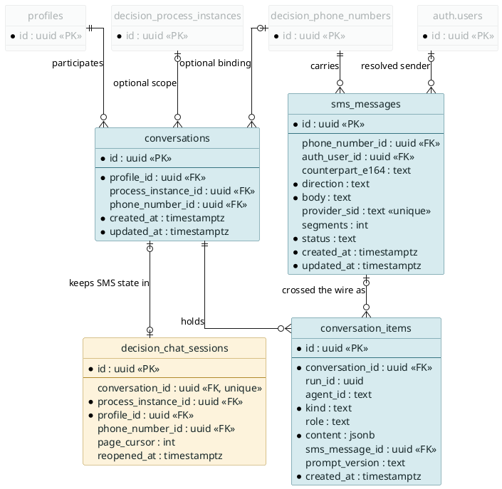
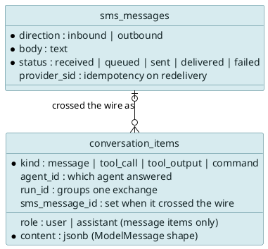

# The problem

ADR: `0023. Add conversation storage tables` (common, branch `issue-1220686869650183`)

- SMS commands, replies, and LLM exchanges leave no record
- The L assistant changes and submits ballots with no audit trail
- Every LLM question starts from zero context — no memory
- Future agents (web UI) need the same storage, not an SMS-shaped one

# Overview

:::: {.columns}

::: {.column style="flex: 0 0 38%"}

| Table | Holds |
| --- | --- |
| `conversations` | one row per thread; channel-agnostic anchor |
| `conversation_items` | ordered, typed items: messages, tool calls, tool outputs, commands |
| `sms_messages` | every SMS crossing a line, with delivery status |
| `decision_chat_sessions` | existing; keeps typed SMS state, gains `conversation_id` |

Items store ModelMessage-compatible jsonb, so a stored thread replays
directly as model input. Domain truth stays in the domain tables
(ADR 0009).

:::

::: {.column style="flex: 1 1 62%"}

:::

::::

# Items and the transport log

- One L exchange: a `user` message, the assistant's `tool_call` /
  `tool_output` items, one `assistant` message
- Tool calls never cross the wire, so they carry no `sms_message_id`
- A stranger's text gets an `sms_messages` row and no item

::: handout
The transport log records traffic before identity: strangers, STOP and
HELP keywords, failed deliveries. The item layer is the reusable
conversation API; SMS is one transport feeding it.
:::
