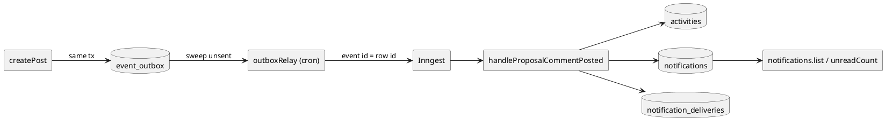
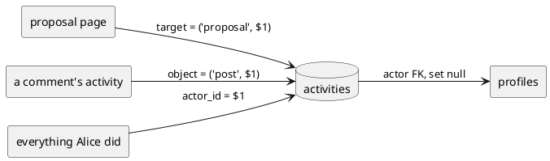

# The demo

::: columns
::: column

{width=100%}

:::
::: column

The unread badge:

```sql
select count(*)
from notifications
where auth_user_id = $1
  and read_at is null;
```

The dropdown rows:

```sql
select a.snapshot, n.read_at,
       n.created_at
from notifications n
join activities a
  on a.id = n.activity_id
where n.auth_user_id = $1
order by n.created_at desc,
         n.id desc
limit 7;
```

:::
:::

# We need to query notifications

::: columns
::: column

{width=100%}

:::
::: column

The All tab, one page per query:

```sql
select n.id, n.category,
       n.seen_at, n.read_at,
       a.verb, a.snapshot,
       n.created_at
from notifications n
join activities a
  on a.id = n.activity_id
where n.auth_user_id = $1
  and (n.created_at, n.id)
      < ($2, $3)
order by n.created_at desc,
         n.id desc
limit 20;
```

The day headers are rendering; the
order is the index's.

:::
:::

# Some notifications have per-user state

::: columns
::: column

{width=100%}

:::
::: column

The Needs-action tab:

```sql
select n.id, a.snapshot,
       n.created_at
from notifications n
join activities a
  on a.id = n.activity_id
where n.auth_user_id = $1
  and n.action_required
  and n.read_at is null
order by n.created_at desc,
         n.id desc;
```

The tab and its count both ride
the needs-action partial index.

:::
:::

# PG Schema

[https://oneprojectorg.github.io/technical-presentations/notifications/notifications-storage.html#(3)](https://oneprojectorg.github.io/technical-presentations/notifications/notifications-storage.html#(3))

# Reworked one event in this new architecture {.dark}

`proposalComment/posted`, end to end on the ADR 0023 model.

The stack: [#2706](https://github.com/oneprojectorg/common/pull/2706) → [#2707](https://github.com/oneprojectorg/common/pull/2707) → [#2708](https://github.com/oneprojectorg/common/pull/2708) → [#2709](https://github.com/oneprojectorg/common/pull/2709)

# The pipeline



Ships as [#2707](https://github.com/oneprojectorg/common/pull/2707) (outbox write + relay), [#2708](https://github.com/oneprojectorg/common/pull/2708) (consumer), and [#2709](https://github.com/oneprojectorg/common/pull/2709) (read API).

# Emitting the event

::: columns
::: column

Before: sent after the commit, inside `waitUntil` — a rollback can
still send, and a crash drops the event.

```ts
// after the commit, in waitUntil
await event.send({
  name: 'proposalComment/posted',
  data: {
    postId,
    proposalId,
    authorProfileId,
  },
});
```

:::
::: column

After: the outbox row commits or rolls back with the post. The relay
does the send.

```ts
// inside db.transaction
await writeOutboxEvent({
  eventName: 'proposalComment/posted',
  payload: {
    postId,
    proposalId,
    authorProfileId,
  },
  db: tx,
});
```

:::
:::

The change in [#2707](https://github.com/oneprojectorg/common/pull/2707): [`createPost.ts` diff](https://github.com/oneprojectorg/common/pull/2707/changes#diff-15b5a5b5fb786c9bb9a50672a1a201fd28015b6f4b3a2c352b5a8d69b5cea19f).

# Delivering the event

::: columns
::: column

The [relay](https://github.com/oneprojectorg/common/pull/2707/changes#diff-2f52b20991097f86238ff70adf143414d5347119aaa0e5d39e217de9efc6113a)
sweeps unsent rows, oldest first. The `sent_at IS NULL`
predicate has a partial index, so the sweep stays fast at any
table size.

```ts
const unsent =
  isNull(eventOutbox.sentAt);
const rows = await db
  .select()
  .from(eventOutbox)
  .where(unsent)
  .orderBy(asc(createdAt), asc(id))
  .limit(100);
```

:::
::: column

Success stamps `sent_at`. Failure only bumps `attempts`; the next
sweep retries.

```ts
for (const row of rows) {
  try {
    // event id = row.id
    await send(buildOutboxEvent(row));
    // set sent_at, attempts + 1
  } catch (error) {
    // attempts + 1, row stays unsent
  }
}
```

A crash between send and stamp re-sends — harmless: the event id is
the row id, and every consumer write dedupes.

:::
:::

The sweep in [#2707](https://github.com/oneprojectorg/common/pull/2707): [`relayOutboxEvents.ts` diff](https://github.com/oneprojectorg/common/pull/2707/changes#diff-2f52b20991097f86238ff70adf143414d5347119aaa0e5d39e217de9efc6113aR19).

# Reading it back

::: columns
::: column

```ts
list: networkAuthenticatedProcedure()
  .input(z.object({ limit, cursor }))
  .output(
    paginated(notificationEncoder))
  .query(({ ctx, input }) =>
    listNotifications({
      authUserId: ctx.user.id,
      ...input,
    })),
```

:::
::: column

The new `notifications` router: `list`, `unreadCount`, `markRead`,
`markAllRead`.

- Thin router: the logic lives in `@op/common`
- Every read and write is scoped `auth_user_id = caller` on the server
- Cursor-paged `{ items, next }`, in the list index's order

:::
:::

The router in [#2709](https://github.com/oneprojectorg/common/pull/2709): [`routers/notifications` diff](https://github.com/oneprojectorg/common/pull/2709/changes#diff-c95b8ecb6bc98d5cbada5e4dc1c8a1233d43f33f43a483d4ea3b0082cd8ac248R13).

# It runs end to end

::: columns
::: column

{width=100%}

The comment goes in; the outbox row commits with it. One relay sweep
later the consumer has written the activity and the notification.

:::
::: column

{width=100%}

The badge and the row read straight from `notifications` and the
activity snapshot. Opening the row stamps `read_at` and `seen_at`.

:::
:::

Live on the local stack; the bell ships in
[#2713](https://github.com/oneprojectorg/common/pull/2713), behind the
`in_app_notifications` feature flag.

# How does this scale?

Valentino's four cases:

- Alice merged proposal A into proposal B
- Bob requested a revision on his review of proposal A
- Alice replied by updating proposal A
- Alice submitted custom form X

# Actor, verb, object, target

::: columns
::: column

The shipped schema, `activities.sql.ts` in [#2706](https://github.com/oneprojectorg/common/pull/2706):

```ts
idempotencyKey: uuid().notNull(),
actorId: uuid()
  .references(() => profiles.id, {
    onDelete: 'set null',
  }),
verb: varchar().notNull(),
objectType: varchar(),
objectId: uuid(),    // no FK
targetType: varchar(),
targetId: uuid(),    // no FK
snapshot: jsonb().notNull(),
```

:::
::: column

The shipped write, `recordProposalCommentActivity.ts` in [#2708](https://github.com/oneprojectorg/common/pull/2708):

```ts
await db
  .insert(activities)
  .values({
    idempotencyKey,
    actorId: authorProfileId,
    verb: Events
      .proposalCommentPosted.name,
    objectType: 'post',
    objectId: postId,
    targetType: 'proposal',
    targetId: proposalId,
    snapshot,
  })
```

:::
:::

One generic relationship to the subject and object of every event.
The actor is always a profile — org, individual, proposal, decision
all have profile rows — so `actor_id` keeps a real FK and sets null.
The object and target are `(type, id)` pairs with no FK: any entity
fits, and the `snapshot` is the record of what the objects looked
like at that point in time, so the row renders after its object is
renamed or deleted.

# Every feed is the same indexed read

Each of actor, object, and target has a partial composite index
`(..., created_at desc, id desc)` (no feed read ships yet):

```sql
select snapshot, created_at
from activities
where target_type = 'proposal'
  and target_id = $1            -- proposal page
--    object_type = 'post'
--    and object_id = $1        -- one comment's activity
--    actor_id = $1             -- everything Alice did
order by created_at desc, id desc
limit 20;
```

A feed an event does not name has no predicate: the org feed and the
process feed read activities only when an event names that entity as
its target. No new column, no migration — a new entity type is just a
new `(type, id)` value.

# The four cases fit the same columns

::: columns
::: column

Three of the verbs already exist — [`services/events/src/types.ts`](https://github.com/oneprojectorg/common/blob/dev/services/events/src/types.ts):

```ts
proposalMerged: {
  name: 'proposal/merged',
  schema: z.object({
    relationshipId:
      z.string().uuid(),
    actorAuthUserId:
      z.string().uuid(),
  }),
},
reviewRevisionRequested: {
  name: 'review/revision-requested',
  schema: z.object({
    assignmentId: z.string().uuid(),
    revisionRequestId:
      z.string().uuid(),
  }),
},
reviewProposalRevisionSubmitted: {
  name: 'review/' +
    'proposal-revision-submitted',
  schema: z.object({
    proposalId: z.string().uuid(),
    proposalHistoryId:
      z.string().uuid(),
    revisionRequestIds: z.array(
      z.string().uuid()).min(1),
  }),
},
```

:::
::: column



The actor is the one FK; every other reference is a `(type, id)`
pair.

Where each case lands when its consumer moves onto the model, like
the comment one did:

| Case | verb | object | target |
| --- | --- | --- | --- |
| merged A into B | `proposal/merged` | `('proposal', A)` | `('proposal', B)` |
| revision requested | `review/revision-requested` | `('proposal', A)` | — |
| revision submitted | `review/proposal-revision-submitted` | `('proposal', A)` | — |
| form X submitted | no event yet | — | — |

:::
:::

No case changes the schema: a review, a merge edge, or a form is just
another `(type, id)` value in the same columns.

# The column-per-scope option

::: columns
::: column

A direct FK column per queryable object — an option, not what we
built:

```sql
actor_profile_id    uuid FK,
organization_id     uuid FK,
process_instance_id uuid FK,
proposal_id         uuid FK,
post_id             uuid FK
-- every FK sets null
```

:::
::: column

What shipped in [#2706](https://github.com/oneprojectorg/common/pull/2706), `activities.sql.ts`:

```ts
actorId: uuid()
  .references(() => profiles.id,
    { onDelete: 'set null' }),
verb: varchar().notNull(),
objectType: varchar(),
objectId: uuid(),   // no FK
targetType: varchar(),
targetId: uuid(),   // no FK
```

:::
:::

The FK columns say what a `(type, id)` pair cannot: the database
checks every reference, and a deleted object sets its column null
instead of dangling. The price: a column, an FK, an index, and a
migration per queryable object — and the org and process feeds only
existed because their columns did.

# The trade: write generically, pay at read time

No feed read ships yet; these are the shapes the two schemas force.

::: columns
::: column

Proposal A's feed on the shipped pairs — one partial index per
reference:

```sql
select a.snapshot, a.created_at
from activities a
where a.target_type = 'proposal'
  and a.target_id = $1
order by a.created_at desc,
         a.id desc
limit 20;
```

When a read needs the live object, the join dispatches on type:

```sql
left join proposals p
  on a.target_type = 'proposal'
 and p.id = a.target_id
-- a deleted object leaves a
-- dangling id: the snapshot
-- still renders the row
```

:::
::: column

The same read on the column option:

```sql
select a.snapshot, a.created_at
from activities a
where a.proposal_id = $1
order by a.created_at desc,
         a.id desc
limit 20;
```

```sql
left join proposals p
  on p.id = a.proposal_id
-- deleted: proposal_id is null,
-- checked by the database
```

:::
:::

The shipped shape pays at read time: the type dispatch in every
predicate and join, and dangling ids the database no longer checks —
the snapshot carries the render either way. What it buys: any entity
in two columns, no migration per new object type, and one query shape
for every feed.


# Appendix

# The four tables

| Table | Holds |
| --- | --- |
| `event_outbox` | the event, written in the domain transaction |
| `activities` | one row per event: actor, verb, object, target |
| `notifications` | one row per recipient, with read state |
| `notification_deliveries` | one row per channel attempt |

Schema PR: [#2706](https://github.com/oneprojectorg/common/pull/2706) — merges on its own, ahead of the stack.

[https://oneprojectorg.github.io/technical-presentations/notifications/notifications-storage.html#(3)](https://oneprojectorg.github.io/technical-presentations/notifications/notifications-storage.html#(3))

# Idempotency, link by link

- The relay sends with the outbox row id as the Inngest event id
- `activities.idempotency_key` is unique: one activity per event
- `(activity_id, auth_user_id)` is unique: one row per recipient
- Email sends skip notifications that already hold a delivery row

A replayed event changes nothing. Delivery is at least once; storage
dedupes every step.


# The pull requests

| PR | What it ships |
| --- | --- |
| [#2706](https://github.com/oneprojectorg/common/pull/2706) | the four tables (stands alone) |
| [#2707](https://github.com/oneprojectorg/common/pull/2707) | outbox write in `createPost` + relay cron |
| [#2708](https://github.com/oneprojectorg/common/pull/2708) | activity, fan-out, deliveries |
| [#2709](https://github.com/oneprojectorg/common/pull/2709) | `notifications.list`, `unreadCount`, `markRead` |
| [#2713](https://github.com/oneprojectorg/common/pull/2713) | the header bell: badge, list, mark read (`in_app_notifications` flag) |

ADR 0023 is merged ([#2532](https://github.com/oneprojectorg/common/pull/2532)).

# What to do next

- Review [#2706](https://github.com/oneprojectorg/common/pull/2706) — it merges on its own
- Then the stack, bottom up: [#2707](https://github.com/oneprojectorg/common/pull/2707) → [#2708](https://github.com/oneprojectorg/common/pull/2708) → [#2709](https://github.com/oneprojectorg/common/pull/2709)
- The MVP bell UI is [#2713](https://github.com/oneprojectorg/common/pull/2713); the full notifications page follows
