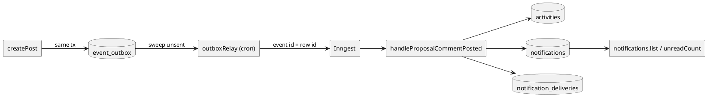

# The demo

::: columns
::: column

{width=100%}

:::
::: column

The unread badge:

```sql
select count(*)
from notifications
where user_id = $1
  and read_at is null;
```

The dropdown rows:

```sql
select a.snapshot, n.read_at,
       n.created_at
from notifications n
join activities a
  on a.id = n.activity_id
where n.user_id = $1
order by n.created_at desc,
         n.id desc
limit 7;
```

:::
:::

# We need to query notifications

::: columns
::: column

{width=100%}

:::
::: column

The All tab, one page per query:

```sql
select n.id, n.category,
       n.seen_at, n.read_at,
       a.event_name, a.snapshot,
       n.created_at
from notifications n
join activities a
  on a.id = n.activity_id
where n.user_id = $1
  and (n.created_at, n.id)
      < ($2, $3)
order by n.created_at desc,
         n.id desc
limit 20;
```

The day headers are rendering; the
order is the index's.

:::
:::

# Some notifications have per-user state

::: columns
::: column

{width=100%}

:::
::: column

The Needs-action tab:

```sql
select n.id, a.snapshot,
       n.created_at
from notifications n
join activities a
  on a.id = n.activity_id
where n.user_id = $1
  and n.action_required
  and n.read_at is null
order by n.created_at desc,
         n.id desc;
```

The tab and its count both ride
the needs-action partial index.

:::
:::

# PG Schema

[https://oneprojectorg.github.io/technical-presentations/notifications/notifications-storage.html#(3)](https://oneprojectorg.github.io/technical-presentations/notifications/notifications-storage.html#(3))

# Reworked one event in this new architecture {.dark}

`proposalComment/posted`, end to end on the ADR 0023 model.

The stack: [#2706](https://github.com/oneprojectorg/common/pull/2706) → [#2707](https://github.com/oneprojectorg/common/pull/2707) → [#2708](https://github.com/oneprojectorg/common/pull/2708) → [#2709](https://github.com/oneprojectorg/common/pull/2709)

# The pipeline



Ships as [#2707](https://github.com/oneprojectorg/common/pull/2707) (outbox write + relay), [#2708](https://github.com/oneprojectorg/common/pull/2708) (consumer), and [#2709](https://github.com/oneprojectorg/common/pull/2709) (read API).

# Emitting the event

::: columns
::: column

Before: sent after the commit, inside `waitUntil` — a rollback can
still send, and a crash drops the event.

```ts
// after the commit, in waitUntil
await event.send({
  name: 'proposalComment/posted',
  data: {
    postId,
    proposalId,
    authorProfileId,
  },
});
```

:::
::: column

After: the outbox row commits or rolls back with the post. The relay
does the send.

```ts
// inside db.transaction
await writeOutboxEvent({
  eventName: 'proposalComment/posted',
  payload: {
    postId,
    proposalId,
    authorProfileId,
  },
  db: tx,
});
```

:::
:::

The change in [#2707](https://github.com/oneprojectorg/common/pull/2707): [`createPost.ts` diff](https://github.com/oneprojectorg/common/pull/2707/changes#diff-15b5a5b5fb786c9bb9a50672a1a201fd28015b6f4b3a2c352b5a8d69b5cea19f).

# Delivering the event

::: columns
::: column

The [relay](https://github.com/oneprojectorg/common/pull/2707/changes#diff-2f52b20991097f86238ff70adf143414d5347119aaa0e5d39e217de9efc6113a)
sweeps unsent rows, oldest first. The `sent_at IS NULL`
predicate has a partial index, so the sweep stays fast at any
table size.

```ts
const unsent =
  isNull(eventOutbox.sentAt);
const rows = await db
  .select()
  .from(eventOutbox)
  .where(unsent)
  .orderBy(asc(createdAt), asc(id))
  .limit(100);
```

:::
::: column

Success stamps `sent_at`. Failure only bumps `attempts`; the next
sweep retries.

```ts
for (const row of rows) {
  try {
    // event id = row.id
    await send(buildOutboxEvent(row));
    // set sent_at, attempts + 1
  } catch (error) {
    // attempts + 1, row stays unsent
  }
}
```

A crash between send and stamp re-sends — harmless: the event id is
the row id, and every consumer write dedupes.

:::
:::

The sweep in [#2707](https://github.com/oneprojectorg/common/pull/2707): [`relayOutboxEvents.ts` diff](https://github.com/oneprojectorg/common/pull/2707/changes#diff-2f52b20991097f86238ff70adf143414d5347119aaa0e5d39e217de9efc6113aR19).

# Reading it back

::: columns
::: column

```ts
list: networkAuthenticatedProcedure()
  .input(z.object({ limit, cursor }))
  .output(
    paginated(notificationEncoder))
  .query(({ ctx, input }) =>
    listNotifications({
      authUserId: ctx.user.id,
      ...input,
    })),
```

:::
::: column

The new `notifications` router: `list`, `unreadCount`, `markRead`,
`markAllRead`.

- Thin router: the logic lives in `@op/common`
- Every read and write is scoped `user_id = caller` on the server
- Cursor-paged `{ items, next }`, in the list index's order

:::
:::

The router in [#2709](https://github.com/oneprojectorg/common/pull/2709): [`routers/notifications` diff](https://github.com/oneprojectorg/common/pull/2709/changes#diff-c95b8ecb6bc98d5cbada5e4dc1c8a1233d43f33f43a483d4ea3b0082cd8ac248R13).

# It runs end to end

::: columns
::: column

{width=100%}

The comment goes in; the outbox row commits with it. One relay sweep
later the consumer has written the activity and the notification.

:::
::: column

{width=100%}

The badge and the row read straight from `notifications` and the
activity snapshot. Opening the row stamps `read_at` and `seen_at`.

:::
:::

Live on the local stack; the bell ships in [#2713](https://github.com/oneprojectorg/common/pull/2713), behind the `in_app_notifications` feature flag.

# Appendix

# The four tables

| Table | Holds |
| --- | --- |
| `event_outbox` | the event, written in the domain transaction |
| `activities` | one feed row per event, scoped by ids |
| `notifications` | one row per recipient, with read state |
| `notification_deliveries` | one row per channel attempt |

Schema PR: [#2706](https://github.com/oneprojectorg/common/pull/2706) — merges on its own, ahead of the stack.

[https://oneprojectorg.github.io/technical-presentations/notifications/notifications-storage.html#(3)](https://oneprojectorg.github.io/technical-presentations/notifications/notifications-storage.html#(3))

# Idempotency, link by link

- The relay sends with the outbox row id as the Inngest event id
- `activities.outbox_id` is unique: one activity per event
- `(activity_id, user_id)` is unique: one row per recipient
- Email sends skip notifications that already hold a delivery row

A replayed event changes nothing. Delivery is at least once; storage
dedupes every step.

# The pull requests

| PR | What it ships |
| --- | --- |
| [#2706](https://github.com/oneprojectorg/common/pull/2706) | the four tables (stands alone) |
| [#2707](https://github.com/oneprojectorg/common/pull/2707) | outbox write in `createPost` + relay cron |
| [#2708](https://github.com/oneprojectorg/common/pull/2708) | activity, fan-out, deliveries |
| [#2709](https://github.com/oneprojectorg/common/pull/2709) | `notifications.list`, `unreadCount`, `markRead` |
| [#2713](https://github.com/oneprojectorg/common/pull/2713) | the header bell: badge, list, mark read (`in_app_notifications` flag) |

ADR 0023 is merged ([#2532](https://github.com/oneprojectorg/common/pull/2532)).

# What to do next

- Review [#2706](https://github.com/oneprojectorg/common/pull/2706) — it merges on its own
- Then the stack, bottom up: [#2707](https://github.com/oneprojectorg/common/pull/2707) → [#2708](https://github.com/oneprojectorg/common/pull/2708) → [#2709](https://github.com/oneprojectorg/common/pull/2709)
- The MVP bell UI is [#2713](https://github.com/oneprojectorg/common/pull/2713); the full notifications page follows
